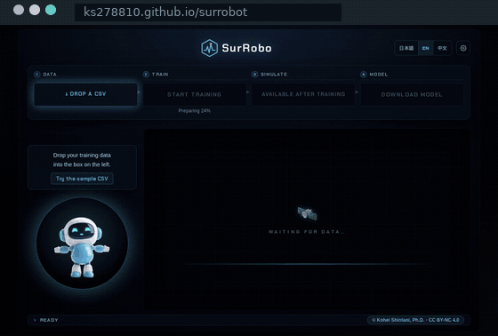
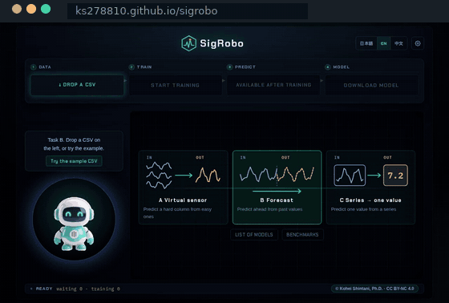

### Kohei Shintani, Ph.D.

自動車工学と機械学習の橋渡し。 
**生成AIによる3D設計 ・ 構造最適化 ・ ベイズ能動学習 ・ 低次元サロゲートモデル** 
Bridging automotive engineering and machine learning, at Toyota / Toyota Research Institute. 
Generative 3D design, structural optimization, Bayesian active learning, and reduced-order models.

**Site:** [ks278810.github.io/website](https://ks278810.github.io/website/) ·
**LinkedIn:** [kohei-shintani-9b20a6175](https://www.linkedin.com/in/kohei-shintani-9b20a6175/) ·
**ResearchGate:** [Kohei-Shintani](https://www.researchgate.net/profile/Kohei-Shintani)

画面と操作をそろえた、データ解析ツールのシリーズ。 
公開中の5つは、ブラウザだけで動きます。データは外に出ません。 
One look, one flow. The five public tools run in your browser, with no upload.

<table>
<tr>
<td align="center" valign="top" width="50%">
 
<b><a href="https://ks278810.github.io/BayesRobo/">BayesRobo</a></b> 
次に試す条件を、AIが提案する。 
Tells you what to try next.
</td>
<td align="center" valign="top" width="50%">
 
<b><a href="https://ks278810.github.io/surrobot/">Surrobot</a></b> 
予測モデルを自動で作り、勝者を選ぶ。 
Builds the models and picks the winner.
</td>
</tr>
<tr>
<td align="center" valign="top" width="50%">
 
<b><a href="https://ks278810.github.io/surrobo-s/">SurRobo-S</a></b> 
データの裏にある式を、見つけ出す。 
Finds the formula behind your data.
</td>
<td align="center" valign="top" width="50%">
 
<b><a href="https://ks278810.github.io/adrobo/">AdRobo</a></b> 
センサーの「いつもと違う」を、見つける。 
Spots what is off in your sensor data.
</td>
</tr>
<tr>
<td align="center" valign="top" width="50%">
 
<b><a href="https://ks278810.github.io/sigrobo/">SigRobo</a></b> 
時系列の予測を、同じ条件で公平に比べる。 
Compares time-series models fairly.
</td>
<td align="center" valign="top" width="50%">
 
<b>SurRobo-D</b> 
作った予測モデルを、exe 1つで渡す。 
Ships your model as a single exe. 
GPUが必要なため、公開デモはありません。 Needs a GPU, so there is no public demo.
</td>
</tr>
</table>

#### ResearchRobo ・ 調べものを、出典つきのレポートに

> 調べたいことを書くだけ。AIチャットのDeep Researchを、出典で裏づけられた証拠ベースのベンチマーク調査レポートに変える無料のプロンプトキット。登録不要、CC BY 4.0。
>
> Free prompt kit that turns a research question into an evidence-based Deep Research workflow.

[ResearchRobo を開く / Open ResearchRobo](https://ks278810.github.io/research-robo/)

#### その他のツール / Other tools

- **[FMUTuner](https://ks278810.github.io/FMUTuner/)** — FMUのパラメータを、試験データに合わせて自動で調整。 Tunes FMU parameters to your test data.
- **[ClearCut](https://github.com/KS278810/ClearCut)** — 動画と画像の背景を除去。 Removes the background from video and images.

#### 研究 / Research

**3D生成設計 / Generative 3D design**

- [VehicleSDF](https://arxiv.org/abs/2410.18986) — 制約つき車両設計の生成モデル。NeurIPS 2024 workshop A DeepSDF-based generative model for constrained vehicle design.
- WheelSDF — ホイール設計のための3D形状生成。ASME IDETC-CIE 2025 Implicit-representation 3D shape generation for wheel design.

**構造最適化 / Structural optimization**

- Data-driven topology optimization using a multitask conditional variational autoencoder with persistent homology — Structural and Multidisciplinary Optimization, 2024 データ駆動のトポロジー最適化。マルチタスク条件付きVAEと永続ホモロジー。
- Multimaterial homologous topology optimization of large telescope structure under multiple elevation conditions — Structural and Multidisciplinary Optimization, 2024 大型望遠鏡構造の、複数の仰角条件でのマルチマテリアルなトポロジー最適化。
- Robust topology optimization of multi-material lattice structures under material and load uncertainties — Frontiers of Mechanical Engineering, 2019 材料と荷重のばらつきに強い、多材料格子構造のロバストトポロジー最適化。

論文の全リスト、60本と特許9件は、[Site](https://ks278810.github.io/website/#research) にあります。 
The full list of 60 papers and 9 patents is on the site.
