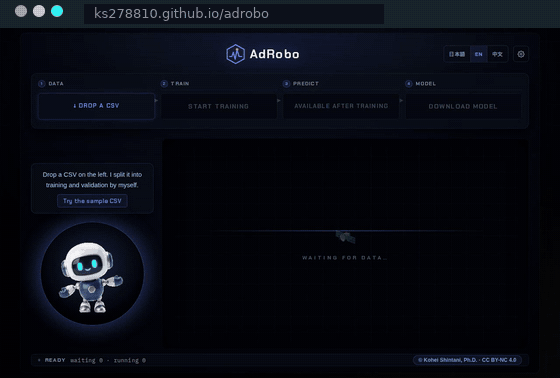

### Kohei Shintani, Ph.D.

自動車工学と機械学習の橋渡し。生成AIによる3D設計、VehicleSDFとWheelSDF、Bayesian Active Learning、低次元サロゲートモデルの研究をしています。 
Bridging automotive engineering and machine learning, with generative 3D design in VehicleSDF and WheelSDF, Bayesian active learning, and reduced-order surrogate models, at Toyota / Toyota Research Institute.

**Site:** [ks278810.github.io/website](https://ks278810.github.io/website/) ·
**LinkedIn:** [kohei-shintani-9b20a6175](https://www.linkedin.com/in/kohei-shintani-9b20a6175/) ·
**ResearchGate:** [Kohei-Shintani](https://www.researchgate.net/profile/Kohei-Shintani)

#### RoboTools

データから答えを引き出す、ロボのシリーズ。画面と操作をそろえてあります。公開中の5つは、ブラウザの中だけで動き、データは外に出ません。 
A series of data tools with one look and one flow. The five public ones run only in your browser, and your data never leaves your machine.

<table>
<tr>
<td align="center" valign="top" width="50%">
 
<b><a href="https://ks278810.github.io/BayesRobo/">BayesRobo</a></b> 
次に試す条件を、AIが提案する。 
Tells you what to try next.
</td>
<td align="center" valign="top" width="50%">
 
<b><a href="https://ks278810.github.io/surrobot/">Surrobot</a></b> 
予測モデルを自動で作り、勝者を選ぶ。 
Builds the models and picks the winner.
</td>
</tr>
<tr>
<td align="center" valign="top" width="50%">
 
<b><a href="https://ks278810.github.io/surrobo-s/">SurRobo-S</a></b> 
データの裏にある式を、見つけ出す。 
Finds the formula behind your data.
</td>
<td align="center" valign="top" width="50%">
 
<b><a href="https://ks278810.github.io/adrobo/">AdRobo</a></b> 
センサーの「いつもと違う」を、見つける。 
Spots what is off in your sensor data.
</td>
</tr>
<tr>
<td align="center" valign="top" width="50%">
 
<b><a href="https://ks278810.github.io/sigrobo/">SigRobo</a></b> 
時系列の予測を、同じ条件で公平に比べる。 
Compares time-series models fairly.
</td>
<td align="center" valign="top" width="50%">
   
<b>SurRobo-D</b> 
作った予測モデルを、exe 1つで渡す。 
Ships your model as a single exe. 
GPUが必要なため、公開デモはありません。 Needs a GPU, so there is no public demo.
</td>
</tr>
</table>

#### その他のツール / Other tools

- **[FMUTuner](https://ks278810.github.io/FMUTuner/)** — FMUのパラメータを、試験データに合わせて自動で調整します。画面のデモは、記録した適合を再生します。 Tunes FMU parameters to your test data. The demo replays a recorded fit.
- **[ClearCut](https://github.com/KS278810/ClearCut)** — 動画と画像の背景を除去します。 Removes the background from video and images.

#### 研究 / Research

- [VehicleSDF](https://arxiv.org/abs/2410.18986) — 制約つき車両設計のための生成モデル。NeurIPS 2024 workshop。 A DeepSDF-based generative model for constrained vehicle design.
- WheelSDF — ホイール設計のための3D形状生成。ASME IDETC-CIE 2025。 Implicit-representation 3D shape generation for wheel design.
