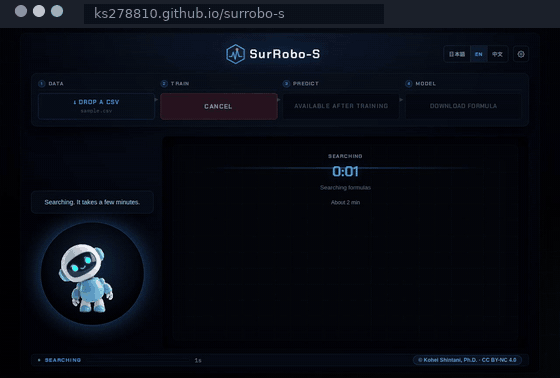

### Kohei Shintani, Ph.D.

Bridging automotive engineering and machine learning — generative 3D design
(VehicleSDF, WheelSDF), Bayesian active learning, and reduced-order surrogate
models, at Toyota / Toyota Research Institute.
自動車工学と機械学習の橋渡し。生成AIによる3D設計、Bayesian Active Learning、
低次元サロゲートモデルの研究をしています。

**Site:** [ks278810.github.io/website](https://ks278810.github.io/website/) ·
**LinkedIn:** [kohei-shintani-9b20a6175](https://www.linkedin.com/in/kohei-shintani-9b20a6175/) ·
**ResearchGate:** [Kohei-Shintani](https://www.researchgate.net/profile/Kohei-Shintani)

#### Tools I've built

The five tools below run entirely in your browser. No install, no upload, and your data never leaves your machine. Built and shipped solo.

<table>
<tr>
<td align="center" valign="top" width="50%">
 
<b><a href="https://ks278810.github.io/BayesRobo/">BayesRobo</a></b> 
Know what to measure next. 
CSVから、次に試す条件を提案します。
</td>
<td align="center" valign="top" width="50%">
 
<b><a href="https://ks278810.github.io/surrobot/">Surrobot</a></b> 
One CSV, every regression model compared. 
CSVを落とすだけで、回帰モデルを自動で比べます。
</td>
</tr>
<tr>
<td align="center" valign="top" width="50%">
 
<b><a href="https://ks278810.github.io/surrobo-s/">SurRobo-S</a></b> 
Find the formula hiding in your data. 
データの式を探します。
</td>
<td align="center" valign="top" width="50%">
 
<b><a href="https://ks278810.github.io/adrobo/">AdRobo</a></b> 
Spot anomalies in sensor data. 
センサーデータの異常を探します。
</td>
</tr>
<tr>
<td align="center" valign="top" width="50%">
 
<b><a href="https://ks278810.github.io/sigrobo/">SigRobo</a></b> 
Time-series models, compared fairly. 
時系列の回帰モデルを同じ条件で比べます。
</td>
<td></td>
</tr>
</table>

Also:

- **[FMUTuner](https://ks278810.github.io/FMUTuner/)** — tunes FMU parameters to your test data. The browser demo replays a recorded fit. FMUTunerは、FMUのパラメータを試験データに合わせて自動で調整します。
- **[ClearCut](https://github.com/KS278810/ClearCut)** — removes the background from video and images. ClearCutは、動画と画像の背景を除去します。
- **SurRobo-D** — needs a GPU, so it has no public release.

#### Research

- [VehicleSDF](https://arxiv.org/abs/2410.18986) — a DeepSDF-based generative model for constrained vehicle design (NeurIPS 2024 workshop).
- WheelSDF — implicit-representation 3D shape generation for wheel design (ASME IDETC-CIE 2025).
