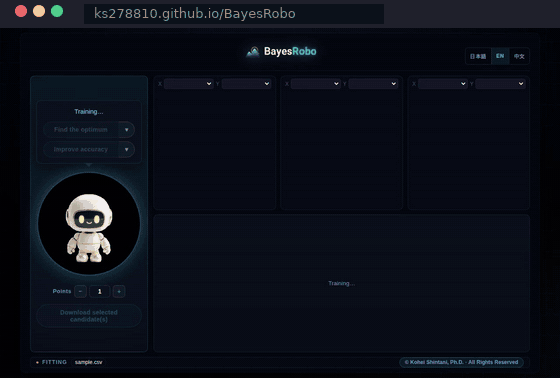
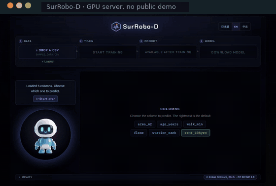
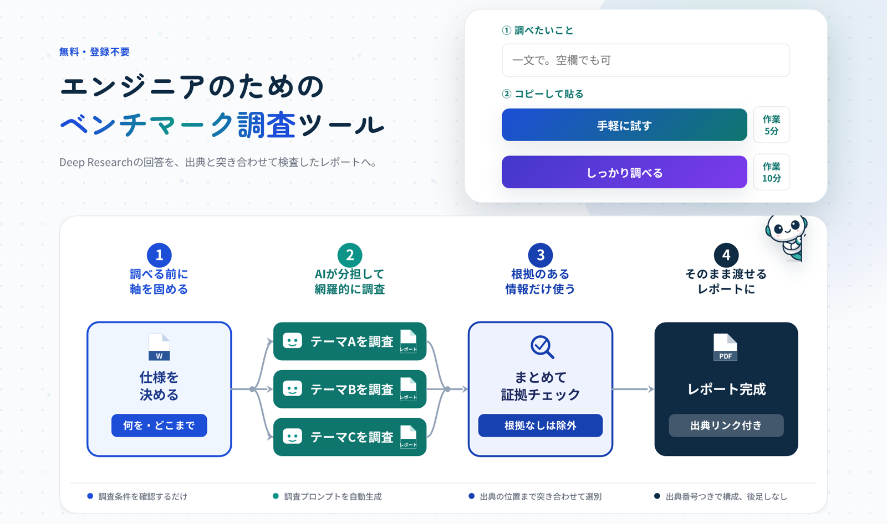

### Kohei Shintani, Ph.D.

自動車工学と機械学習の橋渡しを研究しています。 
**生成AIによる3D設計 ・ 構造最適化 ・ ベイズ能動学習 ・ 低次元サロゲートモデル** 
Research bridging automotive engineering and machine learning. 
Generative-AI 3D design, structural optimization, Bayesian active learning, and reduced-order surrogate models.

**Site:** [ks278810.github.io/website](https://ks278810.github.io/website/) ·
**LinkedIn:** [kohei-shintani-9b20a6175](https://www.linkedin.com/in/kohei-shintani-9b20a6175/) ·
**ResearchGate:** [Kohei-Shintani](https://www.researchgate.net/profile/Kohei-Shintani)

<picture><source media="(prefers-color-scheme: dark)" srcset="assets/robotools-band-dark.png"></picture>

公開中の5つは、ブラウザだけで動きます。データのアップロードは不要です。 
The five public tools run only in your browser. No data upload is needed.

<table width="100%">
<tr>
<td align="center" valign="top" width="50%">
 
<b><a href="https://ks278810.github.io/BayesRobo/">BayesRobo</a></b> 
次に試す条件を、ベイズ最適化で提案する。 
Suggests what to try next.
</td>
<td align="center" valign="top" width="50%">
 
<b><a href="https://ks278810.github.io/surrobot/">SurRobo</a></b> 
予測モデルを自動で作り、勝者を選ぶ。 
Builds the models and picks the winner.
</td>
</tr>
<tr>
<td align="center" valign="top" width="50%">
 
<b><a href="https://ks278810.github.io/surrobo-s/">SurRobo-S</a></b> 
データの裏にある式を、見つけ出す。 
Finds the formula behind your data.
</td>
<td align="center" valign="top" width="50%">
 
<b><a href="https://ks278810.github.io/adrobo/">AdRobo</a></b> 
時系列データの「いつもと違う」区間を、見つける。 
Spots unusual stretches in your time series.
</td>
</tr>
<tr>
<td align="center" valign="top" width="50%">
 
<b><a href="https://ks278810.github.io/sigrobo/">SigRobo</a></b> 
時系列の予測を、同じ条件で比べる。 
Compares forecasting models under the same conditions.
</td>
<td align="center" valign="top" width="50%">
 
<b>SurRobo-D</b> 
作った予測モデルを、exe 1つで渡す。 
Ships your model as a single exe.
</td>
</tr>
</table>

SurRobo-D は GPU が必要なため、公開デモはありません。 / SurRobo-D needs a GPU, so there is no public demo.

#### 研究 / Research

**生成AIによる3D設計 / Generative-AI 3D design**

- [VehicleSDF](https://arxiv.org/abs/2410.18986) — 制約つきの工学設計のための3D生成モデル。NeurIPS 2024 ワークショップ A 3D generative model for constrained engineering design. NeurIPS 2024 workshop.
- WheelSDF — ホイール設計のための3D形状生成。ASME IDETC-CIE 2025 Implicit-representation 3D shape generation for wheel design.

**構造最適化 / Structural optimization**

- Data-driven topology optimization using a multitask conditional variational autoencoder with persistent homology *Structural and Multidisciplinary Optimization*, 2024 データ駆動のトポロジー最適化。マルチタスク条件付きVAEと永続ホモロジー。
- Multimaterial homologous topology optimization of large telescope structure under multiple elevation conditions *Structural and Multidisciplinary Optimization*, 2024 大型望遠鏡構造の、複数の仰角条件でのマルチマテリアルなトポロジー最適化。
- Robust topology optimization of multi-material lattice structures under material and load uncertainties *Frontiers of Mechanical Engineering*, 2019 材料と荷重のばらつきに強い、多材料格子構造のロバストトポロジー最適化。

ResearchGate の登録数で60本、特許9件。全リストは [Site](https://ks278810.github.io/website/#research) の「すべて表示」にあります。 
60 papers as registered on ResearchGate, and 9 patents. The full list is on the site.

#### ResearchRobo ・ 調べものを、出典つきのレポートに
Research, turned into a sourced report. 

<a href="https://ks278810.github.io/research-robo/"><picture><source media="(prefers-color-scheme: dark)" srcset="assets/researchrobo-dark.png"></picture></a>

> 調べたいことを書くだけ。AIチャットのDeep Researchを、出典と突き合わせて検査したレポートに変える無料のプロンプトキット。登録不要、CC BY 4.0。原資料の再確認まではしないため、重要な数値は原資料でも確かめてください。別にAIチャットの有料プランが必要です。
>
> Just write your research question. A free prompt kit that turns AI chat Deep Research into a report checked against its sources. No sign-up, CC BY 4.0. It does not re-open the original sources, so check key numbers there. A paid AI chat plan is needed separately.

[ResearchRobo を開く / Open ResearchRobo](https://ks278810.github.io/research-robo/)

#### その他のツール / Other tools

- **[FMUTuner](https://ks278810.github.io/FMUTuner/)** — FMUのパラメータを、試験データに合わせて調整。公開デモは、記録済みの1回分の再生です。 Tunes FMU parameters to test data. The public demo replays one recorded fit.
- **[ClearCut](https://github.com/KS278810/ClearCut)** — 動画と画像の背景を除去。 Removes the background from video and images.
